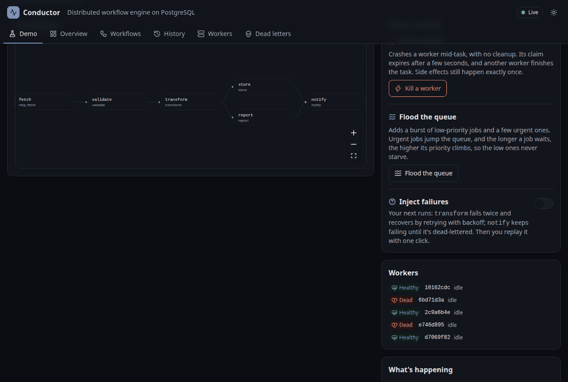
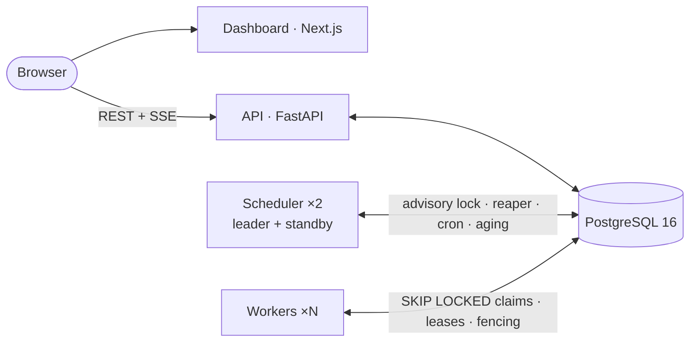

# Quorum

[](https://github.com/Miss-nonso/Quorum/actions/workflows/ci.yml)
[](https://github.com/Miss-nonso/Quorum/actions/workflows/release.yml)


**A distributed job scheduler and workflow engine built on nothing but PostgreSQL. Kill a worker
mid-task and watch the work finish somewhere else, exactly once.**

**[Live demo →](https://quorum.example.com)** · no sign-up · [API docs](https://api.quorum.example.com/docs)



## What you can do in the demo

- **Run** a six-step pipeline (fetch → validate → transform → store ∥ report → notify) and watch
  each step light up as workers claim it.
- **Kill a worker** mid-task. Its lease expires, the reaper requeues the task, another worker
  finishes it, and a fresh worker replaces the dead one. A plain-language feed narrates each step.
- **Flood the queue**: urgent jobs jump ahead, and waiting raises the priority of the rest, so
  nothing starves.
- **Inject failures**: retries with exponential backoff, then the dead-letter queue, then
  one-click replay, which resumes the run.

## Features

- **At-least-once delivery, effectively-once effects.** Idempotency keys behind unique
  constraints ([semantics](docs/semantics.md)).
- **Leases with fencing tokens.** A frozen "zombie" worker can never overwrite the real outcome.
- **DAG workflows.** Validated on save (cycles, references, params); parallel branches; per-node
  failure policies (`retry_then_dead`, `fail_run`, `continue`); data flows between steps by
  reference.
- **Cron with IANA time zones and explicit DST rules.** Skipped local times fire at the jump;
  repeated local times fire once.
- **Leader election** with an advisory lock. Every leader duty is also safe if two schedulers
  briefly overlap.
- **Priority aging**, chosen by benchmark (0.19 ms vs 36 ms per claim at 50k queued).
- **Live dashboard.** One SSE stream with lossless reconnect; React Flow DAG; Gantt timeline;
  workers; dead-letter queue; history. Accessible (axe in CI), dark and light themes, responsive.
- **Operable.** Structured JSON logs with request, run, task and worker ids; Prometheus metrics;
  OpenAPI docs; one-command local stack.
- **No arbitrary code execution.** A small registry of built-in, validated task types
  ([ADR 0007](docs/adr/0007-no-arbitrary-code-execution.md)).

## Architecture



PostgreSQL is the only data store and the only message transport: tasks are rows, claims are
`FOR UPDATE SKIP LOCKED`, wake-ups are `LISTEN/NOTIFY` (a hint only; polling is the safety net).
Details: [docs/architecture.md](docs/architecture.md).

## Quick start

Requires Docker with Compose v2.

```bash
docker compose -f deploy/docker-compose.yml up --build
```

That starts PostgreSQL, runs migrations, seeds the sample workflow, and starts the API, the
scheduler, three chaos-enabled workers and the dashboard.

- Dashboard: <http://localhost:3000>
- API docs: <http://localhost:8000/docs>
- More workers: `docker compose -f deploy/docker-compose.yml up --scale worker=5`

Without containers (uses the Compose database on port 5433): `make dev-host` for the backend and
`make fe-dev` for the dashboard.

## Deploy for free

Vercel (dashboard) + Render (backend, one free web service running `quorum all`) + Neon (free
Postgres): **$0/month**, with a Render Blueprint (`render.yaml`) included. The trade-off is that
the free server sleeps when idle, and the first visitor waits about a minute while it wakes (the
dashboard explains this). Step by step: [docs/deployment-free.md](docs/deployment-free.md). For
an always-on setup on a small VPS, see [docs/deployment.md](docs/deployment.md).

## Development

```bash
make install fe-install   # backend (uv) and dashboard (npm) dependencies
make check                # ruff, mypy --strict, unit + integration + chaos tests, coverage gate
make fe-check             # eslint, prettier, tsc, vitest, production build
make e2e                  # Playwright + axe against a real backend (real workers, really killed)
make bench                # benchmarks (see docs/benchmarks.md)
make help
```

Tests never mock the database: integration and chaos tests run against PostgreSQL 16, and chaos
tests SIGKILL and SIGSTOP real worker, scheduler and API processes.

## Hard problems, and how they're solved

| Problem | Solution | Proven by |
| --- | --- | --- |
| Two workers grabbing the same task | One-statement claim with `FOR UPDATE SKIP LOCKED` | 20 concurrent claimers over 400 tasks: each claimed exactly once |
| A worker dies mid-task | Heartbeat-renewed leases; the reaper requeues lapsed leases with backoff | Chaos test: SIGKILL a real worker; the task finishes elsewhere |
| A frozen "zombie" wakes up and writes a stale result | Monotonic fencing token checked on every write | Chaos test: SIGSTOP, takeover, SIGCONT; the zombie's write is rejected |
| Retries duplicating side effects | At-least-once delivery plus idempotency keys behind unique constraints | Kill after the effect but before completion: one notification |
| Two parents finish at once and both miss the child | Every outcome locks the run row first (run, then task): serialised, deadlock-free | 25-iteration race test, which fails on iteration 2 without the lock |
| Every process killed mid-workflow | All state in Postgres; leases expire; the reaper recovers | SIGKILL everything twice (once after an effect), restart: the run succeeds, effects happen once |
| The scheduler leader dies | Advisory lock on a dedicated session; leader duties are safe to overlap; unique index stops double-firing | Chaos test: SIGKILL the leader; the standby takes over (~0.1 s) and fires the next schedule |
| Low-priority work starving | Periodic aging; claims stay on the index | Starvation test with a no-aging control; benchmark in ADR 0006 |
| DST makes a job run twice or never | Cron evaluated in local time with explicit gap and overlap rules | New York, London and Lagos DST tests, plus property tests |
| A task that crashes every worker it touches | Lease expiry consumes an attempt, so it eventually goes to the DLQ | `test_reaper_dead_letters_a_task_that_keeps_killing_workers` |
| Lost wake-up notifications | `NOTIFY` is only a hint; workers and the SSE hub read by id and always poll | Chaos tests run with LISTEN on and off; SSE replay test |
| Shutdown hanging on open SSE streams | Bounded graceful shutdown | Chaos test that fails without it (hangs > 15 s) |

## Benchmarks

One laptop (i5-1135G7), PostgreSQL 16 in Docker with default, durable settings:

| Measure | Result |
| --- | --- |
| Throughput, no-op tasks (full claim → execute → complete path) | 239–320 tasks/s, bound by durable commits, not workers (533/s with fsync waits off, diagnostic only) |
| Claim round trip, p95 (1 / 16 concurrent claimers) | 10.6 ms / 31.4 ms, including the commit; ≈ 0.2 ms of it is the query |
| Recovery after SIGKILL (6 s lease, demo) / (30 s lease, default) | 6.8 s / 34.9 s median: lease TTL plus one reaper tick |
| Claim with periodic aging vs aging in the query (50k queued) | 0.19 ms vs 35.6 ms p50 |

Method, hardware and how to reproduce: [docs/benchmarks.md](docs/benchmarks.md).

## Limitations (honestly)

- **Single primary.** PostgreSQL is the throughput ceiling and a single point of failure; database
  HA is out of scope ([ADR 0001](docs/adr/0001-postgres-as-the-queue.md) covers when a broker
  wins).
- **Not exactly-once execution.** Handlers can run more than once; only effects keyed by an
  idempotency key are deduplicated. External calls without a dedupe key are at-least-once.
- **Built-in task types only.** That's deliberate for a public demo, and also a real limit on
  generality.
- **Demo rate limits are per API instance** (in memory); global caps live in the database.
- **Recovery takes about one lease TTL.** Faster detection means more false positives for slow
  workers; the TTL is a trade-off, configurable per deployment.
- **Small-scale proof.** Benchmarks are from one laptop; there's no multi-node load test.

## Documentation

- [Architecture](docs/architecture.md) · [Delivery semantics](docs/semantics.md) ·
  [Benchmarks](docs/benchmarks.md) · [Free deployment (Vercel + Render + Neon)](docs/deployment-free.md) ·
  [VPS deployment](docs/deployment.md)
- Architecture decision records:
  [0000 Record decisions](docs/adr/0000-record-architecture-decisions.md) ·
  [0001 PostgreSQL as the queue](docs/adr/0001-postgres-as-the-queue.md) ·
  [0002 At-least-once + idempotency](docs/adr/0002-at-least-once-with-idempotency-keys.md) ·
  [0003 Leases and fencing tokens](docs/adr/0003-leases-and-fencing-tokens.md) ·
  [0004 Advisory-lock leader election](docs/adr/0004-advisory-lock-leader-election.md) ·
  [0005 SSE over WebSockets](docs/adr/0005-sse-over-websockets.md) ·
  [0006 Priority aging](docs/adr/0006-priority-aging.md) ·
  [0007 No arbitrary code execution](docs/adr/0007-no-arbitrary-code-execution.md) ·
  [0008 In-house cron and JSON Schema](docs/adr/0008-in-house-cron-and-json-schema.md)

## Repository layout

| Path | Contents |
| --- | --- |
| `backend/src/quorum/` | `domain/` (pure), `store/` (SQL), `worker/`, `scheduler/`, `api/`, `tasks/`, `demo/` |
| `backend/tests/` | `unit/`, `integration/` (real Postgres), `chaos/` (real processes, SIGKILL/SIGSTOP) |
| `backend/bench/` | Benchmarks |
| `frontend/` | Next.js dashboard, Vitest and Playwright + axe |
| `deploy/` | Compose (dev and prod), Caddyfile, backup script |
| `docs/` | Architecture, semantics, benchmarks, deployment, ADRs |
