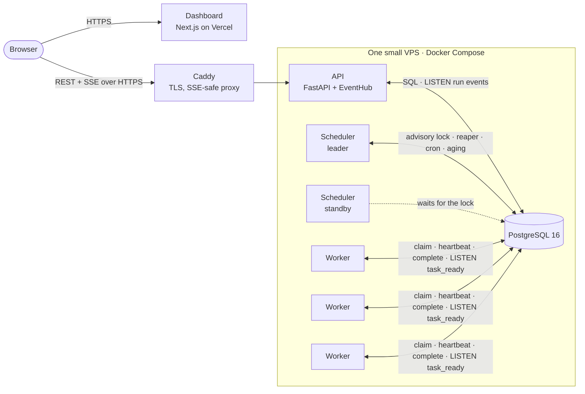
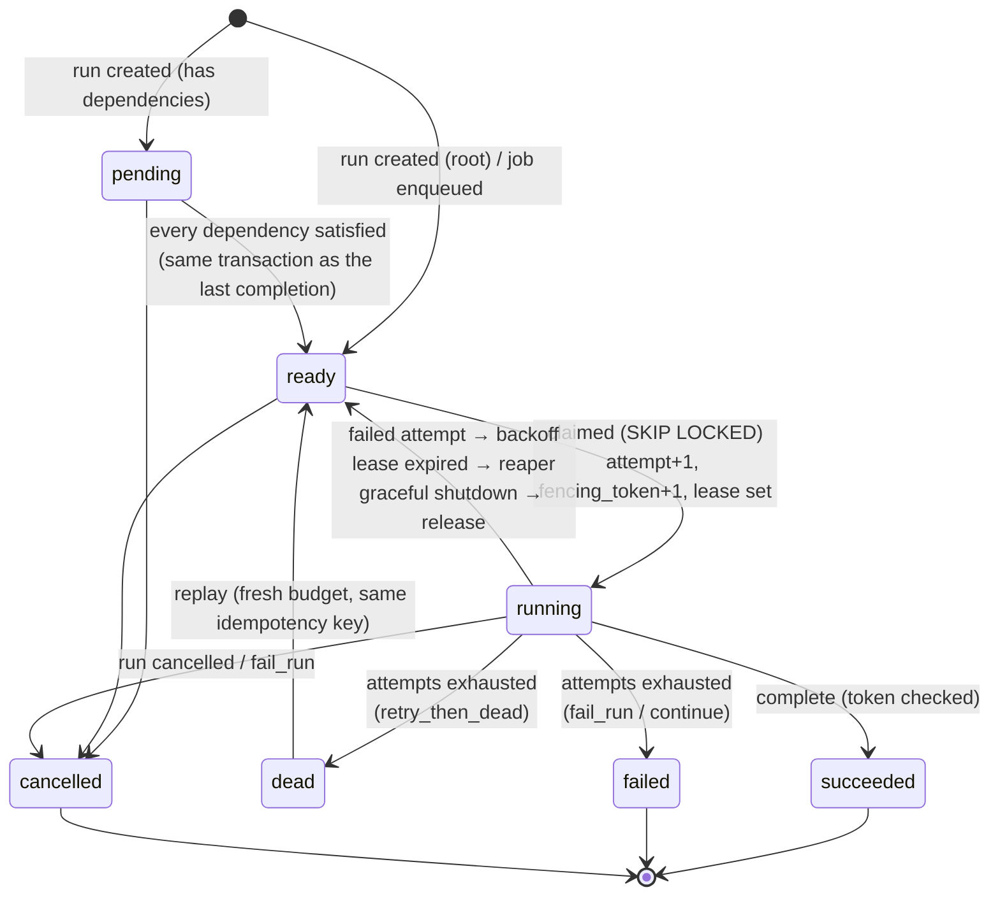
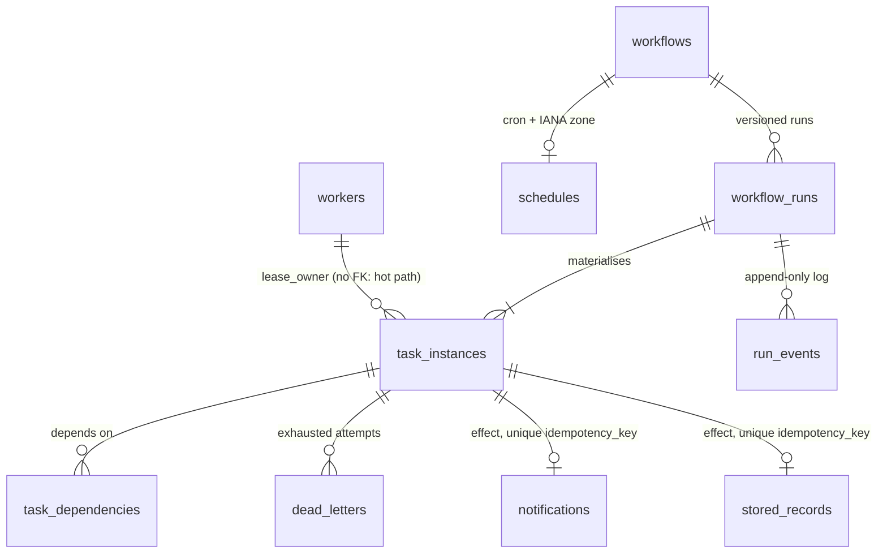
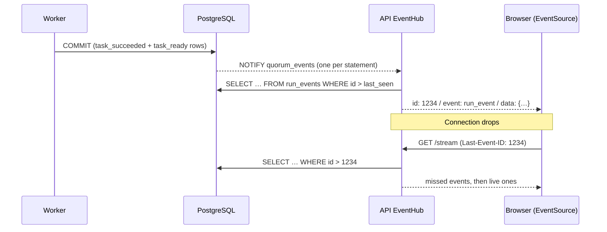

# Architecture

Quorum is three kinds of process around one PostgreSQL database. The processes never talk to
each other directly; they coordinate entirely through rows, row locks, an advisory lock and
(as a latency hint only) `LISTEN/NOTIFY`.

| Process | Count | What it does |
| --- | --- | --- |
| `quorum api` | 1+ | REST under `/api/v1`, the SSE stream, Prometheus metrics, demo controls. Stateless apart from its event hub. |
| `quorum scheduler` | 2 | Campaigns for an advisory lock; the leader runs the reaper, cron firing, priority aging and the demo reset. |
| `quorum worker` | N | Claims tasks with `SKIP LOCKED`, heartbeats to renew leases, executes built-in task types, reports outcomes with its fencing token. |
| `quorum migrate` / `seed` | one-shot | Alembic migrations; the sample workflow. |

All are the same image with a different command.

## The life of a task

1. **Claim.** A worker with free slots runs one statement: a CTE selects ready, due tasks ordered by
   `effective_priority DESC, created_at` with `FOR UPDATE SKIP LOCKED`, updates them to `running`
   with a lease (`now() + lease_ttl`), increments `attempt` and `fencing_token`, and inserts a
   `task_claimed` event. The partial index `(effective_priority DESC, created_at) WHERE status =
   'ready'` makes this an index walk that stops after `LIMIT` rows.
2. **Heartbeat.** Every `heartbeat_interval_s` the worker renews all of its leases in one `UPDATE …
   WHERE fencing_token = :mine`. A lease that no longer renews has been taken over: the worker
   cancels that execution (`lease_lost`).
3. **Execute.** Params are re-validated; `{"$from": node, "path": …}` references are resolved from
   upstream results; the handler runs under a timeout.
4. **Complete.** In one transaction: lock the **run** row, then update the task (conditional on
   status, owner and fencing token), record the event, release dependents whose dependencies are
   now all satisfied, and refresh the run's status. A stale token matches nothing and is recorded as
   `stale_write_rejected`.
5. **Recover.** If the worker vanishes, its lease lapses; the reaper (scheduler leader) records
   `lease_expired` and requeues with backoff, or dead-letters once attempts are spent.

**Lock order.** Every path that changes an outcome locks *run, then task*, so outcome transactions
can't deadlock each other, and concurrent completions in one run are serialised (no stranded
children). The reaper takes both locks with `SKIP LOCKED`, so it never waits on a worker.

## Data model

| Table | Notes |
| --- | --- |
| `task_instances` | Status (CHECK), priority and effective priority, attempts, backoff policy, `not_before`, lease owner and expiry, `fencing_token`, unique `idempotency_key`, result, error, failure policy, demo chaos. A CHECK enforces *lease present ⇔ running*. |
| `run_events` | Append-only. A statement-level trigger sends an empty `NOTIFY quorum_events`. The SSE hub reads rows by id, never from the notification. |
| `schedules` | Next fire time in UTC; a unique `(workflow_id, scheduled_for)` index on runs blocks double firing. |
| `scheduler_state` | One row: who leads (display only; the advisory lock is the authority). |
| `demo_sandboxes`, `worker_commands` | Public demo: visitor sandboxes; kill commands read by chaos-enabled workers on heartbeat. |

Every index is commented with the query it serves in its migration (`backend/alembic/versions`).

## Realtime path

One LISTEN connection per API process, however many browsers. Snapshots of workers and stats
are pushed every 2 s. See ADR 0005.

## Code map

| Path | Responsibility |
| --- | --- |
| `domain/` | Pure logic: task and run state machines, DAG validation, references, backoff, retry decisions, cron with DST rules, priority aging, JSON Schema subset, transforms. Property-tested. |
| `store/` | Hand-written SQL: claiming, leases, outcomes, runs, schedules, aging, read models. |
| `worker/` | Runtime (claim loop, heartbeat, execution, drain) and the task registry. |
| `tasks/` | Built-in task types. No arbitrary code execution (ADR 0007). |
| `scheduler/` | Leader election and the leader's duties. |
| `api/` | Routes, error envelope, request IDs, SSE hub, metrics. |
| `demo/` | Sandboxes, chaos controls, rate limits, reset. |
| `frontend/src` | Views, live data (`lib/live.tsx`), DAG layout, timeline, narration. |

## Scaling notes

- **Workers** scale horizontally (`--scale worker=N`). Claims never block each other.
- **API** instances can be added behind Caddy. Each holds one LISTEN connection; demo rate limits are
  per instance (documented in `demo/limits.py`).
- **The database is the ceiling**: every state change is a durable commit. See
  [benchmarks.md](benchmarks.md) for the measured commit-bound throughput and
  [ADR 0001](adr/0001-postgres-as-the-queue.md) for when a broker would become the right call.
